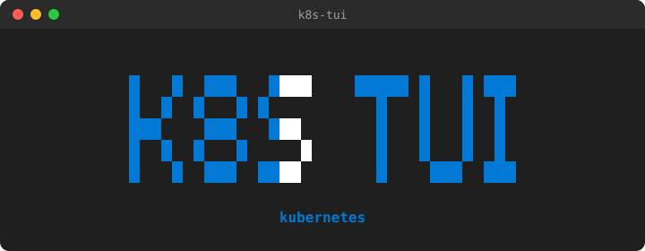

<p align="center">
  
</p>

# k8s-tui

A terminal UI for Kubernetes, written in Go with
[Bubble Tea](https://github.com/charmbracelet/bubbletea),
[Lip Gloss](https://github.com/charmbracelet/lipgloss) and client-go.
It uses your current kubeconfig context, the same one `kubectl` uses, and
shows the kubectl command for everything it does.

```
  Nodes      Pods      Deployments      Services      More

┌─  ns: all  ───  wide: off  ───  refresh: 5s  ───  + run  ───  / search  ─── updated 14:30:05 ─┐
│ default       web-7d9f-abcde   1/1   Running            0            3h                       │
│ default       db-0             0/1   CrashLoopBackOff   4 (5m ago)   1d                       │
│ kube-system   coredns-668d     1/1   Running            0            86d                      │
└─ $ kubectl get pods --all-namespaces ─────────────────────────────────────────── 1-3 of 3 ─┘
```

## Features

- **Nodes, Pods, Deployments, Services** as tabs, live from the cluster,
  with a namespace picker, search, wide columns and auto refresh.
- **Actions** on a row (`enter`): describe, logs (asks which container),
  shell, edit, label, delete, and each kind's own: scale, restart, set
  image, expose, port-forward, cordon, taint, …
- **Every other kind in More**, from ConfigMaps and Secrets to Jobs,
  CronJobs, RBAC, CRDs and their objects, with the columns `kubectl get`
  prints and the commands that kind has (create from entries, decode,
  run now, approve a CSR, `auth can-i`, …).
- **Safe changes**: flags are tick boxes, a change asks for `y` first, and
  `--dry-run=server` shows what it would do.
- **Colors** for how things are (Running, Pending, CrashLoopBackOff) in the
  lists, describe pages and logs.
- **Mouse**: click tabs, buttons and rows, scroll with the wheel, drag to
  select and copy, right click for a menu.

## Install

Download the binary for your system from the
[releases](https://github.com/sathiraumesh/k8s-tui/releases)
(Linux, macOS and Windows, amd64 and arm64):

```sh
chmod +x k8s-tui_*_linux_amd64
./k8s-tui_*_linux_amd64
```

On macOS, if it is blocked: `xattr -d com.apple.quarantine k8s-tui_*`.

Shell, Edit, Port-forward and a node's shell run `kubectl`, so it needs to
be installed.

## Build

You need Go 1.26+.

```sh
go run .              # run it
go build -o k8s-tui . # or build it
./k8s-tui --version
```

## Keys

`←→` tabs • `↑↓` move • `tab` focus • `enter` actions • `+` new •
`n` namespace • `/` search • `w` wide • `r` refresh rate • `esc` back •
`q` quit. All of them, the mouse, and every kind's actions are in
[docs/keys.md](docs/keys.md).

## Test

```sh
go test ./...
```

The tests use client-go's fake cluster, so they don't need a real one. An
end-to-end run of every feature against a [kind](https://kind.sigs.k8s.io)
cluster (it makes and deletes the namespace `k8s-tui-e2e`):

```sh
go test -tags e2e ./internal/mvc -run TestE2E -v
```

## Releases

CI tests every push and pull request, and makes releases itself: it builds
the binaries for every system and creates the release with them and their
`SHA256SUMS`. Start one either way:

```sh
git tag v0.1.0 && git push origin v0.1.0
```

or on GitHub: **Actions › CI › Run workflow**, and type the version
(`v0.1.0`); it tags the latest commit of `main`. A version with a `-`
(`v0.2.0-rc.1`) is a pre-release.

How the code is laid out is in [docs/architecture.md](docs/architecture.md).
